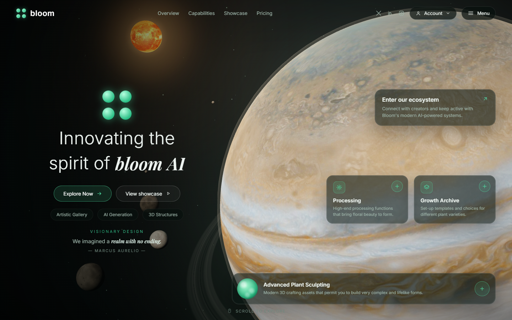
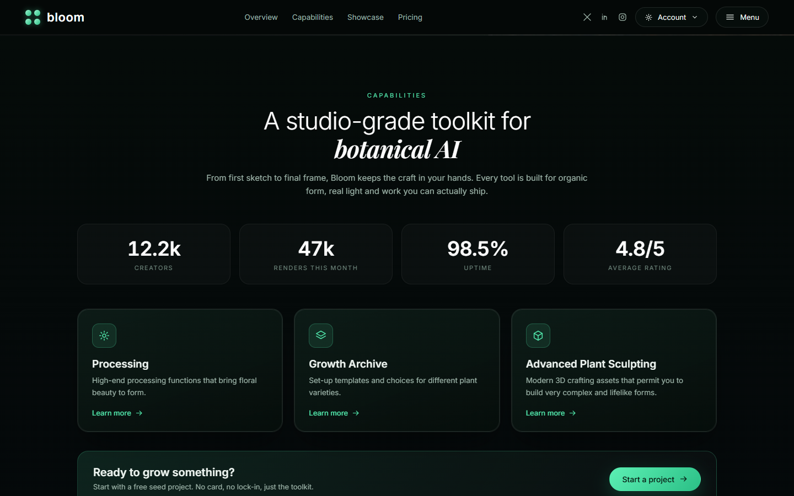
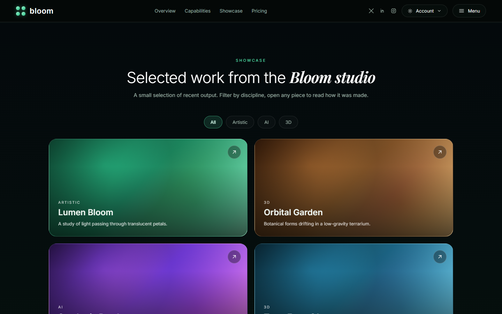
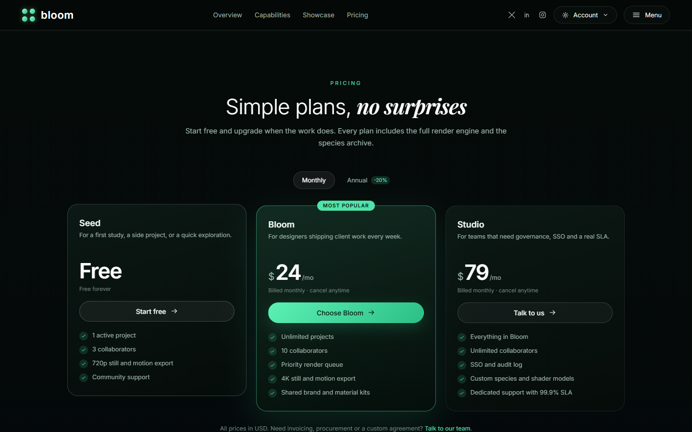
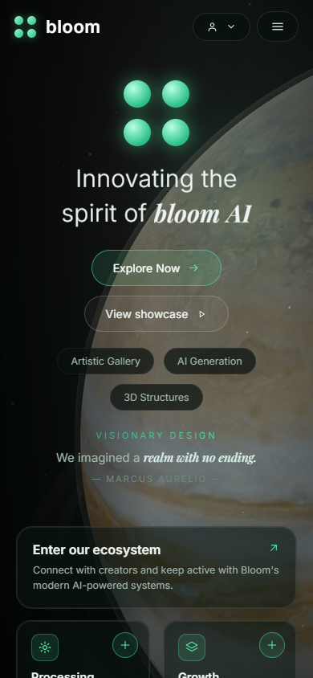

# Bloom AI — Cinematic Jupiter Landing Page


A cinematic marketing site for a fictional botanical-AI studio. The hero is a real-time WebGL Jupiter — 4K surface, orbiting Galilean moons, a distant sun — with a full site underneath and every clickable element wired to a real interaction.



## Highlights

- **Real-time 4K Jupiter** — 3840×1920 texture, ACES Filmic tone mapping, sRGB output, atmosphere rim, 0.94 polar flattening, tuned anisotropic filtering.
- **Galilean moons** — Io, Europa, Ganymede and Callisto with procedural surfaces (Europa has an icy shell with reddish lineae), independent orbits and tidally locked rotation. Plus 18 small moons representing the wider Jovian system and a distant sun.
- **A complete site** — fixed navigation, hero, capabilities with animated stats, showcase with discipline filters and a lightbox, pricing with monthly/annual billing, and a footer with newsletter signup.
- **Every button does something** — menu drawer, sign in / sign up, lead form, feature detail modals, work lightbox, add-to-workspace toggles, pricing switch, newsletter validation, account state, toasts, `Esc` / backdrop close, smooth scrolling.
- **Built for integrated GPUs** — no bloom pass, no `backdrop-filter`, DPR capped at 1.5 with adaptive fallback, 3D rendering paused when the hero is offscreen. Measured ~120 FPS on an Intel UHD 630.
- **Responsive** — desktop, tablet and mobile layouts.

## Screenshots

| Capabilities | Showcase |
| --- | --- |
|  |  |

| Pricing | Mobile |
| --- | --- |
|  |  |

## Tech stack

| Layer | Choice |
| --- | --- |
| Framework | React 19 + TypeScript 7 |
| Build | Vite 8 |
| 3D | Three.js r187 |
| Motion | GSAP + `@gsap/react`, Motion |
| Components | [react-bits](https://github.com/DavidHDev/react-bits) — SplitText, SpotlightCard, GradientText, ClickSpark, CountUp |
| Styling | Hand-written CSS (custom properties, no utility framework) |

## Getting started

Requires **Node 20+**.

```bash
npm install
npm run dev       # http://localhost:5173
npm run build     # type-check + production build
npm run preview   # preview the production build
```

## Deploy to GitHub Pages

This repo ships a workflow at `.github/workflows/deploy.yml` that builds the app and publishes `dist` to GitHub Pages.

1. Push the project to a GitHub repository.
2. In the repository: **Settings → Pages → Build and deployment → Source: GitHub Actions**.
3. The workflow runs on every push to `main`; the site is published at `https://<user>.github.io/<repo>/`.

`vite.config.ts` uses a relative `base`, so the build works from a project subpath. The optional `redirect.html` is a styled standalone forwarder — set `CUSTOM_TARGET` inside it if you want to point at a different deployed URL.

> **Upload the contents of this folder, not the folder itself.** If the repository root contains a nested `bloom-ai-jupiter/` folder, GitHub Pages serves from the wrong path and the app will not load.

## Project structure

```text
.
├─ .github/workflows/         # GitHub Pages build + deploy
├─ docs/                      # README screenshots
├─ public/                    # favicon
├─ src/
│  ├─ assets/textures/        # 4K Jupiter + Sun textures
│  ├─ components/             # react-bits components + 3D scene
│  │  ├─ ClickSpark/
│  │  ├─ CountUp/
│  │  ├─ GradientText/
│  │  ├─ JupiterScene.tsx     # Jupiter, moons, sun, camera, renderer
│  │  ├─ SplitText/
│  │  ├─ SpotlightCard/
│  │  └─ Starfield.tsx
│  ├─ site/                   # page sections, modals, data, styles
│  │  ├─ Site.tsx             # page composition + interaction state
│  │  ├─ Header.tsx
│  │  ├─ Hero.tsx
│  │  ├─ Capabilities.tsx
│  │  ├─ Showcase.tsx
│  │  ├─ Pricing.tsx
│  │  ├─ Footer.tsx
│  │  ├─ Modal.tsx
│  │  ├─ Toast.tsx
│  │  ├─ Icons.tsx
│  │  ├─ data.ts
│  │  └─ site.css
│  ├─ App.tsx
│  ├─ main.tsx
│  ├─ index.css
│  └─ bloom.css               # hero + background styles
├─ index.html
├─ redirect.html              # optional standalone forwarder
├─ package.json
├─ tsconfig*.json
└─ vite.config.ts
```

## Interactions

| Element | Behaviour |
| --- | --- |
| Menu | Right-side drawer with navigation, about, contact, CTA and socials |
| Account | Sign in / sign up modal (validated, persisted to `localStorage`); once signed in, avatar menu with plan and sign-out |
| Explore Now / View showcase | Smooth scroll to the corresponding section |
| Hero tags | Set the showcase filter and scroll to it |
| Hero cards | Open a capability detail modal |
| `+` buttons | Add / remove a capability from the workspace, persisted, with toast |
| Feature cards | Detail modal with description, bullets and CTA |
| Work cards | Lightbox with gradient artwork, description, tags and CTA |
| Pricing toggle | Monthly / annual prices update live |
| Plan buttons | Open the lead form (validated, success state, leads stored in `localStorage`) |
| Newsletter | Email validation with inline error and success toast |
| Footer links | Internal anchors, info modals (About / Careers / Status / Privacy / Terms) and external docs links |
| Social icons | Open X, LinkedIn and Instagram |

> Auth, leads and newsletter are **demo-only** and stay in the browser via `localStorage`. No backend is required to run the site.

## Performance notes

The first version used an UnrealBloom pass, layered `backdrop-filter` over a live WebGL canvas and a 256-segment sphere — that combination was the source of the jank on integrated graphics. This version:

- replaces bloom with a cheap sprite glow,
- removes every `backdrop-filter`,
- draws the starfield once instead of running a second `requestAnimationFrame` loop,
- caps DPR at 1.5 with an adaptive drop to 1.25 / 1.0,
- pauses 3D rendering when the hero is out of view,
- caps texture anisotropy at 4 (the single biggest win: 55 → 119 FPS on an Intel UHD 630),
- uses a 160-segment sphere and a 4K texture with mipmaps.

## Credits

- **react-bits** by David Haz — MIT + Commons Clause — https://github.com/DavidHDev/react-bits
- **Planet textures** — Solar System Scope — CC BY 4.0 — https://www.solarsystemscope.com/textures/ (via Wikimedia Commons)
- **Three.js** — MIT — https://threejs.org
- **GSAP** — GreenSock license — https://gsap.com
- **Motion** — MIT — https://motion.dev
- **Fonts** — Inter and Playfair Display, SIL Open Font License 1.1, via Google Fonts

Full details in [THIRD_PARTY_NOTICES.md](THIRD_PARTY_NOTICES.md).

## License

The original code in this repository is released under the [MIT License](LICENSE). Third-party components and assets keep their own licenses — see [THIRD_PARTY_NOTICES.md](THIRD_PARTY_NOTICES.md).
